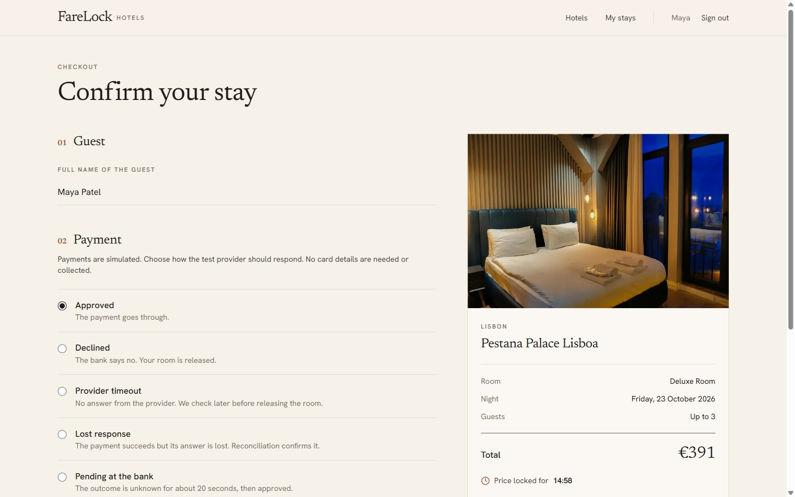
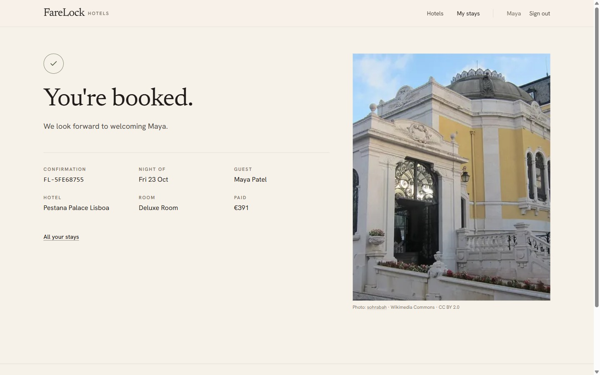
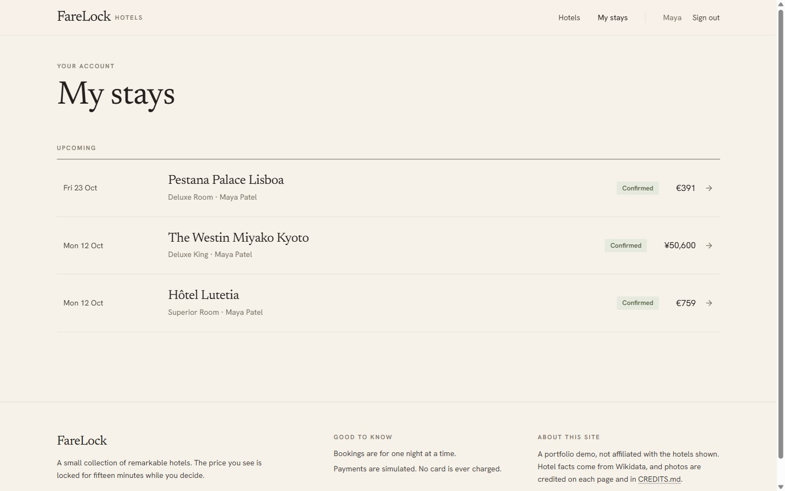
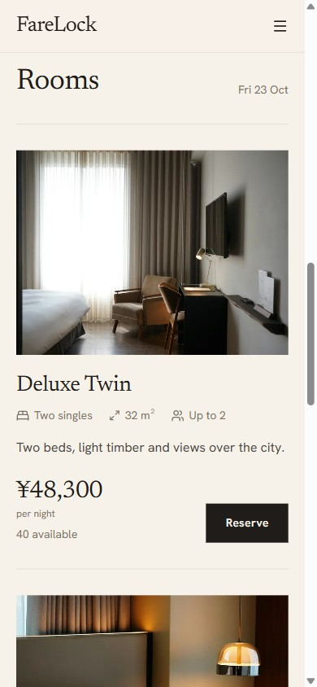
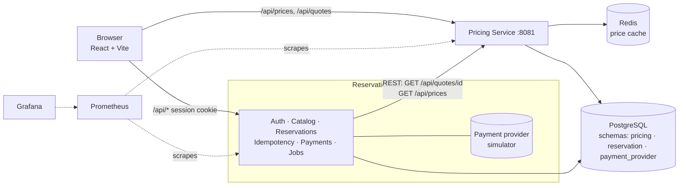
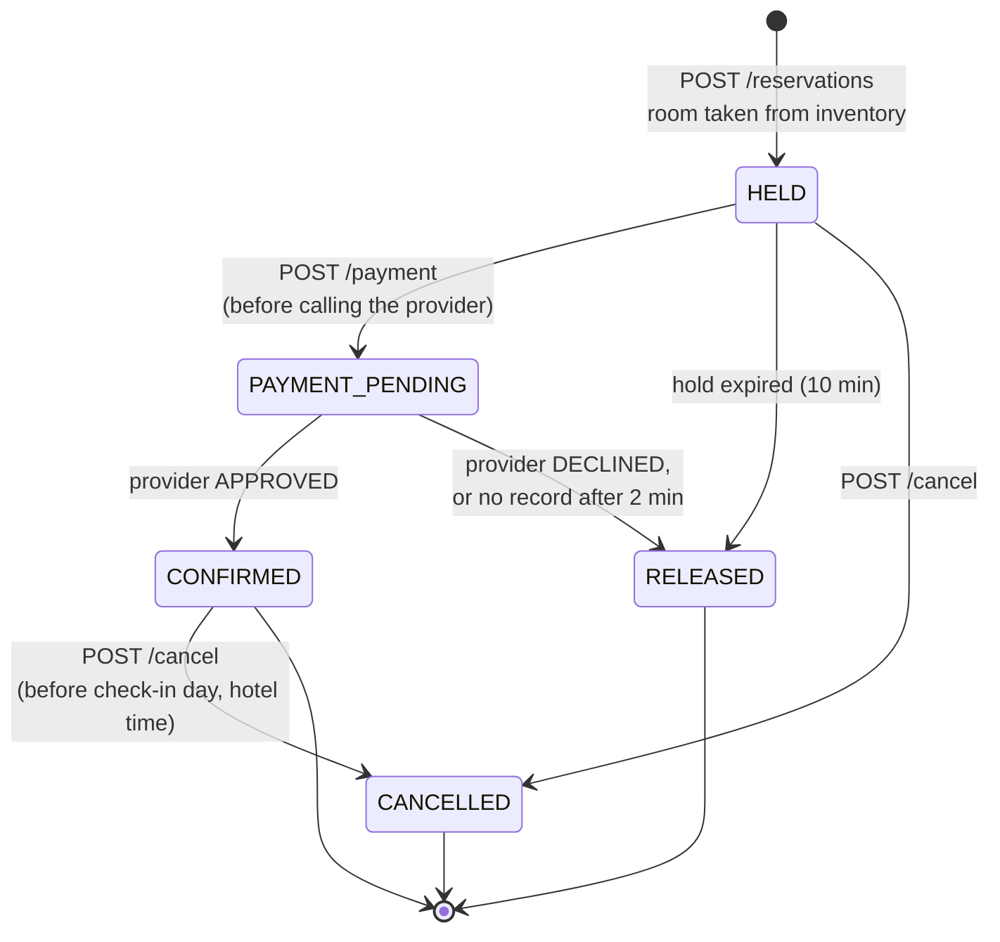
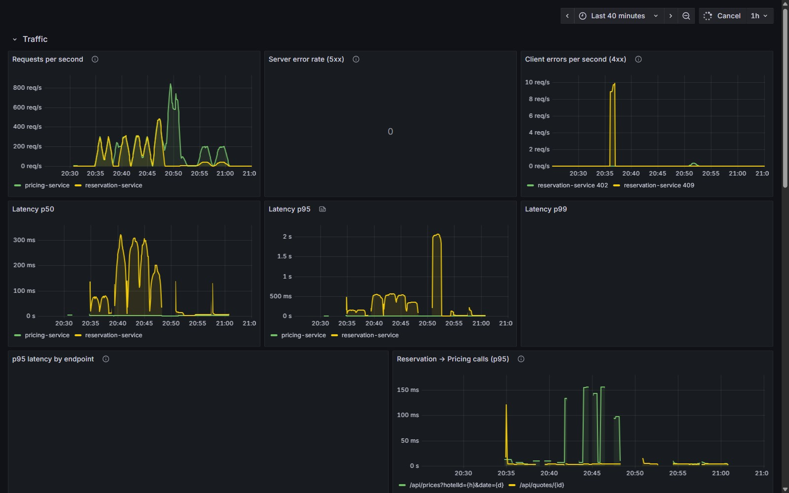
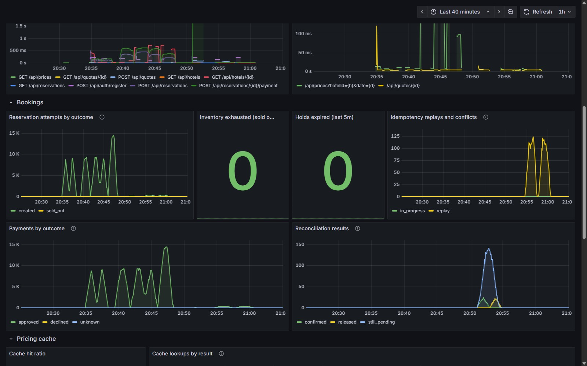

# FareLock

A hotel reservation system built as two Kotlin + Spring Boot services, PostgreSQL, Redis and a React frontend.
It is small on purpose: ten real hotels, one-night stays and a simulated payment provider. It focuses on the parts of
booking systems that are hard to get right:

- **No overselling.** 100 customers racing for 10 rooms produce exactly 10 bookings, proven by tests and real k6 traffic.
- **Idempotent bookings.** Retries, double clicks and concurrent duplicates never create a second booking or a second charge.
- **Recoverable payments.** Timeouts and lost responses are reconciled against the provider instead of guessed at.
- **Observable.** Prometheus metrics, a provisioned Grafana dashboard, structured logs with request ids.
- **Measured.** One real bottleneck found with k6, Grafana and `pg_stat_activity`, then fixed for +50% throughput ([docs/benchmark.md](docs/benchmark.md)).


| Hotel | Checkout | Confirmation |
|---|---|---|
|  |  |  |
| **Search** | **My stays** | **Mobile** |
|  |  |  |

> Portfolio project, not affiliated with any hotel shown. Hotel names and locations are real (Wikidata). Rooms, prices and
> availability are demo data. Payments are simulated and no card data is ever collected. Photo credits are in [CREDITS.md](CREDITS.md).

---

## Architecture



| Service | Owns | Main endpoints |
|---|---|---|
| **Pricing** (`pricing-service/`) | `pricing` schema: base rates, quotes | `GET /api/prices`, `POST /api/quotes`, `GET /api/quotes/{id}` |
| **Reservation** (`reservation-service/`) | `reservation` schema: users, sessions, hotels, inventory, reservations, idempotency keys. `payment_provider` schema: the simulated provider's charges and refunds | `/api/auth/*`, `/api/me`, `/api/hotels`, `/api/reservations`, `/api/reservations/{id}/payment`, `/api/reservations/{id}/cancel` |

Each service logs in to Postgres with its own role and can only see its own schema(s). The services talk over REST with
short timeouts. There is no message broker, gateway or service discovery, because none is needed at this size.
Design choices and their tradeoffs are recorded in [docs/decisions.md](docs/decisions.md).

## Tech stack

**Backend:** Kotlin 2.2, Spring Boot 4.0 (Spring MVC, Spring JDBC, no JPA), Java 21, PostgreSQL 17, Redis 7.4, Flyway,
kotlinx.coroutines (in a few focused places), BCrypt from `spring-security-crypto`.
**Frontend:** React 19, TypeScript, Vite, Tailwind CSS 4, React Router, Motion, Lucide.
**Ops and testing:** Actuator + Micrometer, Prometheus, Grafana, k6, JUnit 5 + Testcontainers, Docker Compose, Gradle (Kotlin DSL).

---

## Running it locally

**Prerequisites:** JDK 21, Docker (Desktop), Node 20+ with pnpm.

```bash
# 1. Infrastructure (Postgres + Redis). Edit the passwords in .env first.
cp .env.example .env
docker compose --env-file .env up -d

# 2. Services, in two terminals (each reads ../.env)
cd pricing-service && ./gradlew bootRun
cd reservation-service && ./gradlew bootRun

# 3. Frontend
cd frontend && pnpm install && pnpm dev     # http://localhost:5173
```

Flyway creates the schemas and seeds ten hotels on first start, and a job keeps 90 days of inventory stocked.
To get started, **register any email/password on the site**: no demo account is needed. On the checkout page, choose how
the simulated payment provider should respond.

Logs are JSON by default. Set `LOG_FORMAT=` (empty) for plain text while developing.

| Port | What |
|---|---|
| 5173 | Frontend (Vite dev server, proxies `/api` to the services) |
| 8081 / 8082 | Pricing / Reservation services |
| 5442 / 6390 | Postgres / Redis (non-default ports to avoid clashes) |
| 9091 / 3001 | Prometheus / Grafana (monitoring profile) |

## API examples

```bash
# Browse (public)
curl "localhost:8082/api/hotels?destination=Paris&date=2026-11-20"
curl "localhost:8081/api/prices?hotelId=3&date=2026-11-20"

# Register: the session arrives as an HttpOnly cookie
curl -c jar -H 'Content-Type: application/json' localhost:8082/api/auth/register \
  -d '{"email":"ada@example.com","password":"correct horse","fullName":"Ada Lovelace"}'

# Lock a price for 15 minutes
curl -H 'Content-Type: application/json' localhost:8081/api/quotes -d '{"roomTypeId":301,"stayDate":"2026-11-20"}'
# -> {"id":"<quoteId>","amount":793.50,"protectionFee":79.35,"currency":"EUR","expiresAt":"...","expired":false}   (690 base x 1.15 Friday)

# Hold the room. Repeat this exact call: you get the same reservation back.
curl -b jar -H 'Content-Type: application/json' -H 'Idempotency-Key: 6f1c-checkout-1' localhost:8082/api/reservations \
  -d '{"quoteId":"<quoteId>","roomTypeId":301,"stayDate":"2026-11-20","guestName":"Ada Lovelace","cancellationProtection":true}'

# Pay (simulated): tok_approve | tok_decline | tok_timeout | tok_lost_response | tok_unknown
curl -b jar -H 'Content-Type: application/json' localhost:8082/api/reservations/<id>/payment -d '{"paymentToken":"tok_approve"}'

# Cancel. Before check-in day starts at the hotel; protected stays get the room price back
curl -b jar -X POST localhost:8082/api/reservations/<id>/cancel

curl -b jar localhost:8082/api/reservations
```

Errors always look like `{"code": "SOLD_OUT", "message": "..."}`. The main codes are: `SOLD_OUT` (409),
`IDEMPOTENCY_KEY_REUSED` (409), `REQUEST_IN_PROGRESS` (409), `QUOTE_EXPIRED` (422), `PRICING_UNAVAILABLE` (503),
`PAYMENT_DECLINED` (402), `HOLD_EXPIRED` (409), `CANCELLATION_CLOSED` (409), `PAYMENT_IN_PROGRESS` (409), `DATABASE_UNAVAILABLE` (503) and `UNAUTHENTICATED` (401).

---

## How booking works



1. **Quote.** Pricing computes `base × 1.15 (Fri/Sat) × 1.10 (within 7 days)` in `BigDecimal`, rounds to the currency's minor unit and stores a snapshot that expires after 15 minutes.
2. **Reserve.** The reservation service claims the `Idempotency-Key`, fetches the quote with **no transaction open**, then in **one transaction** inserts the reservation, records the response for replays, and takes a room with a single conditional `UPDATE`.
3. **Pay.** The reservation moves to `PAYMENT_PENDING` first, so hold expiry can't give the room away mid-payment. Then the provider is called with a 2-second timeout, using the reservation id as its idempotency key.
4. **Outcome.** Approved means `CONFIRMED`. Declined means `RELEASED` and the room goes back on sale. Timeout or unknown returns `202` and the UI shows "Confirming your payment…" while it polls.
5. **Reconcile.** Every 10 seconds a job asks the provider about stuck payments and applies what it says: confirm, release, or keep waiting. The same job releases expired holds, retries unconfirmed refunds and keeps inventory stocked.
6. **Cancel.** Allowed until the stay date begins in the hotel's time zone. At checkout the guest picks **free cancellation** (+10%, quoted by Pricing) or **non-refundable**. Cancelling frees the room in one transaction that also records any refund owed (`PENDING`). The provider is then asked to refund the room price (the fee is kept), keyed `refund:<id>`, so retries by the request or the reconciler pay out once. Non-refundable stays keep the charge.

### Concurrency: why 100 buyers can't get 11 rooms

```sql
UPDATE room_inventory SET held = held + 1
WHERE room_type_id = ? AND stay_date = ? AND held + booked < total   -- 0 rows updated = SOLD_OUT
```

The check and the change are one statement. Postgres locks the row while it runs, so concurrent requests apply one at a
time against the latest values, and a `CHECK (held + booked <= total)` constraint is the backstop. No `synchronized`, no
`SELECT ... FOR UPDATE` dance. `ConcurrencyTest` releases 100 threads at once with a `CountDownLatch` (no sleeps) and
asserts exactly 10 winners. The k6 contention scenario shows the same result over real HTTP.

### Idempotency

`(user_id, idempotency_key)` is a primary key, so concurrent duplicates can't both claim it. The booking and its stored
response commit **together**:

| Situation | Response |
|---|---|
| Same key, same body, finished | The stored response, replayed byte-for-byte (`201` with the same reservation) |
| Same key, different body | `409 IDEMPOTENCY_KEY_REUSED` |
| Same key, still running | `409 REQUEST_IN_PROGRESS` (retry shortly) |
| Temporary failure (pricing down) | Key released, so the same key can be retried |
| Process crashed mid-request | Key reclaimable after 60s |

Everything lives in Postgres, so it holds across restarts and across multiple instances. Paying is idempotent through the
reservation's state plus the provider's per-reservation key, so a reservation can never be charged twice.

### Failure handling

| Failure | What happens | Covered by |
|---|---|---|
| Redis down | Cache errors count as misses, prices come from Postgres, and Redis is skipped for 5s after a failure | `RedisOutageTest`, `failure-recovery.js` |
| Pricing down | Browsing still works with "price unavailable". Booking returns `503 PRICING_UNAVAILABLE` and the key can be retried | `CatalogTest`, `ReservationTest` |
| Payment timeout | `202`. Released only after the provider still has no record 2 minutes later | `PaymentTest` |
| Lost response (charged, answer lost) | Reconciler finds `APPROVED` and confirms, with exactly one charge | `PaymentTest`, k6 |
| Crash after approval, before confirm | Same reconciliation path | `PaymentTest` |
| Refund call fails or times out | Refund stays `PENDING`, the reconciler retries the same refund key, and the provider pays out once | `CancellationTest` |
| Insert fails after taking a room | The transaction rolls back and the inventory is unchanged | `ReservationTest` |
| Database unreachable | Hikari gives up after 2s and returns `503 DATABASE_UNAVAILABLE`. Recovers on its own when Postgres returns | verified manually |

---

## Observability

```bash
docker compose --env-file .env --profile monitoring up -d
```

Open Grafana at **http://localhost:3001** (anonymous read-only access locally; admin password in `.env`). The **FareLock**
dashboard is provisioned automatically:

- **Traffic:** requests/s, 5xx rate, 4xx by status, p50/p95/p99 latency, p95 by endpoint, Reservation→Pricing call latency.
- **Bookings:** reservation outcomes (including `sold_out` for inventory exhaustion), idempotency replays and conflicts, payment outcomes, reconciliation results, expired holds.
- **Pricing cache:** hit ratio, hits/misses/errors.
- **Resources:** JVM heap, CPU, HikariCP active/waiting connections and wait time, threads.




Custom metrics use only low-cardinality tags (`outcome`/`result`). Never user ids, reservation ids or keys.
Every request carries an `X-Request-Id` (taken from the caller or generated). It appears in every JSON log line and is
forwarded to the pricing service, so one booking can be followed across both services.

## Load testing with k6

k6 runs in Docker and only targets the hidden load-test hotel (id 99) and `loadtest+…@farelock.test` users. The scripts
refuse to run against non-local URLs.

```bash
# Reset load-test data (touches nothing else)
docker compose --env-file .env exec -T postgres psql -U postgres -d farelock -f - < load-tests/reset.sql

# Run a scenario (Git Bash on Windows: prefix with MSYS_NO_PATHCONV=1)
docker compose --env-file .env --profile loadtest run --rm k6 run /scripts/inventory-contention.js
docker compose --env-file .env --profile loadtest run --rm -e VUS=100 -e DURATION=60s k6 run /scripts/concurrent-reservations.js
```

| Script | What it checks |
|---|---|
| `mixed.js` | Realistic mix: 45% search, 25% hotel pages, 15% prices, 15% bookings (some with retries) |
| `pricing-load.js` | Fixed-rate pricing throughput and latency (cache on vs `FARELOCK_CACHE_ENABLED=false`) |
| `concurrent-reservations.js` | Many simultaneous book + pay flows. Rooms taken must equal bookings confirmed |
| `idempotency-stress.js` | 10 identical requests at once per booking, plus double payment. Duplicates must be 0 |
| `inventory-contention.js` | 100 customers, 10 rooms. Exactly 10 succeed |
| `failure-recovery.js` | Timeouts and lost responses while you `docker compose stop redis`. Nothing may be left unresolved |

`VUS`, `DURATION` and `RATE` are configurable. Successful and failed requests are counted separately
(`farelock_succeeded_requests` / `farelock_failed_requests`), and each script asserts correctness, not just speed.

## Tests

```bash
cd pricing-service && ./gradlew test        # rules, quotes, caching, Redis outage
cd reservation-service && ./gradlew test    # auth, idempotency, concurrency, payments, recovery
cd frontend && pnpm build                   # type-check + production build
```

The tests are integration tests against real Postgres and Redis via Testcontainers (Docker must be running), with a
small in-process HTTP stub standing in for the pricing service. The full browser journey
(register → search → book → pay → My stays, plus the lost-response recovery) was verified with Playwright at desktop
and mobile sizes.

## Benchmarks

Real, local measurements, with their method and caveats, are in **[docs/benchmark.md](docs/benchmark.md)**. In short:

- **Investigation:** under 100 concurrent bookings for one night, the database pool looked saturated, but a bigger pool
  didn't help. `pg_stat_activity` showed row-lock contention on the inventory row, made worse by the lock being taken
  *first* in its transaction. Taking it last raised throughput from **150 to 224 bookings/s** (+50%) and cut p95 reserve
  latency from **342 to 203 ms**.
- **An honest null result:** locally, the Redis cache does not make prices faster (p95 about 3 ms either way). It takes
  about 99% of reads off Postgres.

---

## Design decisions, limitations, next steps

Key decisions (each with its tradeoff) are in [docs/decisions.md](docs/decisions.md): plain SQL over JPA, service-owned
schemas, sessions over JWTs, conditional updates over locks, idempotency in the business transaction, reconciliation over
retries, and coroutines only where they help (concurrent fan-out, a bounded payment call).

**Limitations**
- One night per booking, one room per booking. Cancellation is all-or-nothing (no partial penalties).
- One Postgres instance for both services (separate schemas and roles, shared failure domain).
- The payment provider is simulated in-process. A charge that settles after we released the room (timeout, then late approval) is not auto-refunded yet.
- `/internal/jobs/run` (manual job trigger) is unauthenticated and meant only for local demos.
- No rate limiting on login, and no email verification or password reset.
- Benchmarks are from one laptop. A hot single-night row is the worst case on purpose.

**Next steps:** multi-night stays (one inventory row per night in the same transaction), auto-refunding late-settling charges,
login rate limiting, a transactional outbox for confirmation emails, splitting very hot inventory rows into buckets,
and container images for both services.

---

Built by [@shreshta-p](https://github.com/shreshta-p). Photo and data credits: [CREDITS.md](CREDITS.md).
